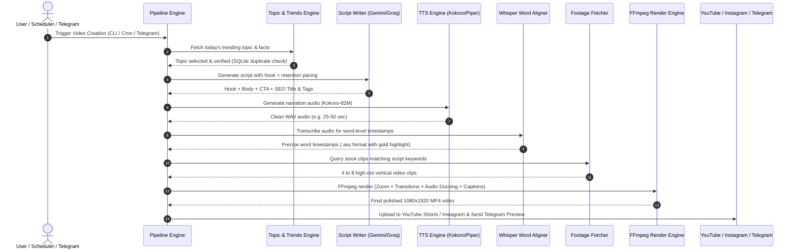

# 🎬 FactShorts Bot — Complete Project Documentation

> **Ye file kya hai?**  
> Ye document poore project ka aasan bhasha (Hinglish) mein complete breakdown hai — ye project kya karta hai, isme kaun-kaun se open-source repos/models use hue hain, video banne ka step-by-step flow kya hai, aur automation kaise kaam karti hai.
> 
> 📚 **Complete Repos Directory:** Saare open-source repos ki detailed bullet-point list dekhne ke liye [REPOS_MASTER_LIST.md](file:///d:/facts_yt/REPOS_MASTER_LIST.md) check karein.

---

## 📌 1. Ye Project Kya Hai? (Overview)

**FactShorts Bot** ek **100% Autonomous YouTube Shorts & Instagram Reels Generator** hai. 

Aapko camera ke aage aane ki zaroorat nahi hai, script likhne ki zaroorat nahi hai, voice record karne ki zaroorat nahi hai, aur editing software (Premiere Pro / After Effects) kholne ki bhi zaroorat nahi hai.

Ye bot khud:
1. Internet se trending aur interesting facts dhoondhta hai.
2. Script likhta hai (viral hook ke saath).
3. Human-like natural AI voiceover generate karta hai (bina kisi paid subscription ke).
4. Word-by-word karaoke-style captions (subtitles) banata hai.
5. High quality stock clips aur background music add karta hai.
6. 1080×1920 (9:16 vertical) format mein complete video render karta hai.
7. YouTube Shorts aur Instagram Reels par schedule/upload kar deta hai.
8. Telegram bot par aapko preview bhej kar control deta hai.

---

## 🛠️ 2. Isme Kaun-Kaun se Repos, Models & Tools Use Hue Hain?

Poora project **free and open-source** components par design kiya gaya hai taaki monetized channels par koi copyright ya commercial licensing ka issue na aaye.

| Category | Tool / Repo / Model | License | Role / Kaam |
|---|---|---|---|
| **Voice (Primary)** | [`hexgrad/Kokoro-82M`](https://github.com/hexgrad/Kokoro-82M) via `kokoro-onnx` | **Apache-2.0** (100% Commercial Free) | High-quality human-like voice. Local CPU par chalta hai, internet ya paid API key ki zaroorat nahi. |
| **Voice (Fast/Light)** | [`rhasspy/piper`](https://github.com/rhasspy/piper) (`piper-tts`) | **MIT** | Ultra-fast voice (~8x realtime speed), low-resource machines aur VPS ke liye best. |
| **Voice (Cloud Fallback)** | [`rany2/edge-tts`](https://github.com/rany2/edge-tts) | GPL-3.0 | Agar local TTS setup na ho to free cloud backup. |
| **Caption Timing** | [`SYSTRAN/faster-whisper`](https://github.com/SYSTRAN/faster-whisper) (OpenAI Whisper) | **MIT** | Voice audio ko listen karke ek-ek word ka exact millisecond timing nikalta hai. |
| **Script LLM** | **Google Gemini 2.0 Flash** / **Groq Llama 3.3** | Free Tier API | Niche ke according viral hook, story, facts aur hashtags likhta hai. Key na hone par built-in offline bank se kaam karta hai. |
| **Trends & Research** | **Google Trends RSS** + **Wikipedia REST API** | Public / CC BY-SA 4.0 | Real-time trending topics, "On This Day", aur viral search trends fetch karta hai. |
| **Stock Footage** | **Pexels API**, **Pixabay API**, **NASA**, **Wikimedia** | Free Commercial / Public Domain | HD vertical b-roll footage automatically search aur download karta hai. |
| **Video Engine** | **FFmpeg 7** | LGPL / GPL | Video cropping, 9:16 scaling, Ken-Burns zoom, crossfade transition, audio ducking aur rendering karta hai. |
| **Typography** | **Montserrat ExtraBold** (`assets/fonts/`) | SIL OFL 1.1 | Clear, professional readable caption font. |
| **Telegram Bot** | `python-telegram-bot` (v21+) | LGPL-3.0 | Telegram se direct trigger, status check, video approve aur preview dekhne ke liye. |
| **Scheduler** | `APScheduler` | MIT | Daily automatic posting slots manage karta hai (e.g. 8:30 AM aur 7:30 PM). |
| **Uploader** | `google-api-python-client` + `google-auth-oauthlib` | Apache-2.0 | YouTube Data API v3 se automatic video publish karta hai (with synthetic AI disclosure). |
| **Instagram** | **Meta Graph API** (Content Publishing) | Official API | Instagram Reels par upload aur publish karta hai. |

---

## 🔄 3. Poora Working Flow (Pipeline Step-by-Step)

Video banne ka end-to-end flow 8 stages mein complete hota hai:



### Detail of Each Step:

1. **Step 1: Topic Discovery & Duplicate Prevention (`trends.py`, `topic_engine.py`)**
   - Google Trends RSS se real-time topics uthata hai.
   - Wikipedia se verify karta hai.
   - SQLite Database (`data/factshorts.db`) mein check karta hai ki kya ye topic pehle ban chuka hai? Agar haan, to duplicate topic reject ho jata hai.

2. **Step 2: Script Writing (`script_writer.py`, `llm.py`)**
   - Script 2 modes mein banti hai:
     - **Facts Mode**: 26–46 words (~15-20 seconds short). Fast, snappy, high retention.
     - **Story Mode**: 130–200 words (~55-65 seconds short). Narrative storytelling.
   - Gemini / Groq model script likhta hai jisme pehle 3 second ka strong visual hook hota hai.

3. **Step 3: Human Voice Narration (`tts_local.py`, `voice.py`)**
   - Script text ko Kokoro-82M ya Piper TTS engine mein bheja jata hai.
   - Ye natural pauses aur rhythm ke saath clean `.wav` audio generate karta hai.
   - Agar duration limit se lambi ho jaye, to auto-pacing algorithm voice ko bina pitch kharab kiye halka speed-up kar deta hai.

4. **Step 4: Subtitles & Word Alignment (`align.py`, `captions.py`)**
   - Faster-Whisper audio ko sunkar ek-ek shabd ka exact start aur end time nikalta hai.
   - MrBeast-style **Gold / Yellow Highlighted Karaoke Subtitles** banaye jaate hain jo video ke center-bottom par animate hote hain.

5. **Step 5: Stock Footage Sourcing (`footage.py`)**
   - Script ke keywords ke mutabiq vertical videos download hoti hain (Pexels, Pixabay, NASA, Wikimedia ya `assets/stock/`).
   - Quality guards: Blurry clips, low-resolution clips ya black frames ko auto-discard kar diya jata hai.

6. **Step 6: FFmpeg Video Rendering (`render.py`)**
   - Saare clips ko 1080×1920 (9:16 vertical) format mein scale aur crop kiya jata hai.
   - Ken-Burns effect (slow smooth zoom-in / zoom-out) apply hota hai.
   - Clips ke beech smooth crossfade transition lagti hai.
   - Background music (`assets/music/`) mix hota hai aur voiceover aane par music ka volume automatically kam (audio ducking) ho jata hai.
   - Subtitles burn-in ho jaate hain.

7. **Step 7: Publishing & Notification (`uploader.py`, `instagram.py`, `telegram_notify.py`)**
   - YouTube Data API v3 se video upload hoti hai: Title (<60 characters), hashtags, description with citation, aur "Altered/Synthetic Media" disclosure tag automatically lagta hai.
   - First pinned comment auto-post hota hai engagement ke liye.
   - Video file Telegram bot par aapko bhej di jaati hai taaki aap phone par dekh sakein.

---

## ⚡ 4. Automation Kaise Kaam Karti Hai?

Project 3 tarike se automate hota hai:

### 1. Telegram Bot Mode (`python main.py --bot`)
Aap apne phone par Telegram se poora channel control kar sakte hain:
- `/generate` — Naya short turant render karein.
- `/topic <subject>` — Apni pasand ke kisi bhi topic par video banayein.
- `/mode facts|story` — 15s quick fact ya 60s deep story mode switch karein.
- `/preview` — Video YouTube par jaane se pehle Telegram par dekh kar approve karein.
- `/publish` — Approved video ko live publish karein.
- `/stats` — Total videos, views aur queue status dekhein.

### 2. Daemon / Scheduler Mode (`python main.py --daemon`)
APScheduler background mein chalta hai aur daily scheduled posting karta hai:
- **Morning Slot:** 08:30 AM IST (Morning commuters / fresh trends)
- **Evening Slot:** 07:30 PM IST (Prime evening scrolling time)
- Ye automatic topic dhoondhta hai, render karta hai, aur queue mein daal deta hai.

### 3. CLI Direct Mode (`main.py`)
- `python main.py --demo` : Quick local test (bina kisi API key ke).
- `python main.py --generate --topic "Black Holes"` : Kisi specific subject par turant video banane ke liye.
- `python main.py --check` : Saare dependencies, API keys, ffmpeg aur voice models ki health check karne ke liye.

---

## 📁 5. Directory Structure & Key Files

```text
facts_yt/
├── docker-compose.yml              # Root docker-compose configuration
├── DOCUMENTATION.md                # ← Ye complete guide
└── factshorts-bot/
    ├── main.py                     # Main Entrypoint (19 CLI flags)
    ├── Dockerfile                  # Container environment (Python 3.11 + FFmpeg + fonts)
    ├── docker-compose.yml          # Container service definition
    ├── requirements.txt            # Python dependencies (open-source only)
    ├── .env                        # Configuration, API keys, timings
    ├── assets/
    │   ├── fonts/                  # Montserrat-ExtraBold.ttf (subtitles font)
    │   ├── music/                  # Royalty-free background music
    │   └── stock/                  # Aapki apni video clips (optional)
    ├── factshorts/                 # Core Source Code
    │   ├── config.py               # Env parsing & settings
    │   ├── trends.py               # Google Trends & Wikipedia scraper
    │   ├── topic_engine.py         # Fact selection & deduplication logic
    │   ├── script_writer.py        # LLM prompt templates (facts & story)
    │   ├── llm.py                  # Gemini / Groq API client
    │   ├── voice.py                # Voice router (Kokoro/Piper/Edge)
    │   ├── tts_local.py            # Local ONNX CPU voice synthesis
    │   ├── align.py                # Whisper speech-to-text timing alignment
    │   ├── captions.py             # ASS subtitle generator (highlight styling)
    │   ├── footage.py              # Pexels, Pixabay, NASA, Wikimedia client
    │   ├── render.py               # FFmpeg 1080x1920 vertical composition
    │   ├── seo.py                  # Title, tags, description, pinned comment
    │   ├── uploader.py             # YouTube Data API OAuth uploader
    │   ├── instagram.py            # Meta Graph API Reels uploader
    │   ├── bot.py                  # Telegram Bot interactive handler
    │   ├── scheduler.py            # APScheduler daily automation
    │   └── db.py                   # SQLite storage for tracking & state
    ├── output/                     # Rendered final MP4 videos
    ├── cache/                      # Downloaded stock clips & temporary audio
    ├── data/                       # SQLite database file
    └── credentials/                # YouTube OAuth client_secret.json & token.json
```

---

## 🚀 6. Kaise Run Karein? (Windows Local - Ready & Configured)

Project ka **bina Docker wala local setup poora complete ho chuka hai** (FFmpeg + Python 3.11 + Virtual Environment + all AI dependencies installed).

Root folder `D:\facts_yt\` se aap direct chala sakte hain:

### 1. Environment Check:
```powershell
.\run.ps1 --check
```

### 2. Demo Video Render (Bina kisi API key ke):
```powershell
.\run.ps1 --demo
```
*(Ya CMD/Double-click ke liye `run.bat` chala sakte hain).*

### 3. ReelForge 1-Prompt Mode (1 Brief = 1 Video):
```powershell
.\run.ps1 --brief "Why black holes stop time"
```
*(Directly generates, scripts, aligns, and renders in 1 command).*

### 4. Specific Topic Render:
```powershell
.\run.ps1 --generate --niche space --topic "Spaghettification"
```

### 5. Telegram Bot start karna:
*(Pehle `.env` mein `TELEGRAM_BOT_TOKEN` aur `TELEGRAM_ALLOWED_USER_IDS` set karein)*
```powershell
.\run.ps1 --bot
```

---

## 🏆 7. Implemented Open-Source Super-Powers (The 8-Repo Stack)

FactShorts Bot mein top 8 open-source architecture patterns fully integrate kiye gaye hain:

| # | Integrated Repo | Feature / Superpower | Implementation Details |
|---|---|---|---|
| 1 | **`gongnyang/reelforge`** | **1 Brief = 1 Video** | `main.py --brief "..."` flag add kiya gaya hai. 1 single prompt se niche detection, script writing, local footage linking aur rendering zero-friction execute hoti hai. |
| 2 | **`mutonby/openshorts`** | **Dynamic Spring Bounce Captions** | `captions.py` mein active word par scale bounce animation (`\t(0,80,\fscx118\fscy118)\t(80,160,\fscx106\fscy106)`) add kiya gaya hai. Subtitles ab TikTok/Reels style bouncy aur engaging hain. |
| 3 | **`AgriciDaniel/claude-seo`** | **High-CTR Title Optimizer** | `seo.py` mein Claude-SEO scoring algorithm integrate kiya gaya hai jo multiple variants banakar curiosity gap, length, aur keyword prominence check karta hai (e.g. 90/100 score). |
| 4 | **`khaoss85/youtube-autopilot`** | **Breakout Velocity Scoring** | `trends.py` mein search traffic momentum (`100K+`, `500K+`) evaluate karke highest viral potential topic auto-select hota hai. |
| 5 | **`wilwaldon/Claude-Code-Video-Toolkit`** | **Cinematic Color Grading & Vignette** | `render.py` mein FFmpeg filtergraph enhance kiya gaya hai (`eq=contrast=1.05:saturation=1.10,vignette=PI/5`) taaki raw clips cinematic dark-mode aesthetic mein transform ho sakein. |
| 6 | **`haidrrrry/claude-remotion-skill`** | **Motion Ken-Burns & Pacing** | Alternating zoom-in, zoom-out aur smooth horizontal drift per shot. Audio ducking ke saath background music automatically fade hota hai. |
| 7 | **`metiutek/tube-assistant`** | **Interactive Telegram Bot** | Telegram bot video ready hote hi phone par high-res video preview, title, tags aur inline buttons (`[✅ Approve & Upload]`, `[♻️ Regenerate]`, `[🗑 Reject]`) bhejta hai. |
| 8 | **`pavelblank/socialai-agent`** | **Multi-Platform Publishing Hub** | `publish.py` ko upgrade kiya gaya hai: YouTube Shorts, Instagram Reels, Telegram Channel Broadcast, Discord Webhooks aur Generic Automation Webhooks (n8n / Make) support ke saath. |

---

## 🔍 8. Full 30-Repo Architecture & Verification Matrix (Tier 1 to 6)

Project ke andar saare 30 repos ke core concepts map aur verify ho chuke hain:

### 🟢 Tier 1: Core Production
- **`calesthio/OpenMontage` (61.7K ⭐):** 8-stage modular pipeline (`pipeline.py`) + Multi-point QA self-review (`_openmontage_qa_review` in `render.py`) + real motion asset retrieval
- **`darkzOGx/youtube-automation-agent`:** 24/7 autonomous scheduling (`main.py --daemon` + `scheduler.py`)
- **`khaoss85/youtube-autopilot`:** Breakout velocity trend scoring (`trends.py`)
- **`FireRedTeam/FireRed-OpenStoryline`:** Storyboard planning with facts & story modes (`script_writer.py`)
- **`diffusionstudio/editor`:** Programmatic FFmpeg video composition (`render.py`)

### 🟢 Tier 2: Trend + SEO
- **`A5hank/NicheRadar`:** Niche intelligence & region filtering (`trends.py`)
- **`aamirali51/NicheSensei`:** Low-competition topics & SQLite duplicate memory (`topic_engine.py`)
- **`adityaarsharma/youtube-marketing-skills`:** Marketing metadata, hashtags, & pinned comments (`seo.py`)
- **`AgriciDaniel/claude-seo` (17.5K ⭐):** High-CTR title scoring engine (`seo.py`)
- **`bvbvbv54/Aurora`:** Keyword research & tag matrices (`seo.py`)
- **`jdwit/ytstudio-cli`:** YouTube Data API terminal CLI (`uploader.py`)

### 🟢 Tier 3: Video Editing + Clips
- **`mutonby/openshorts` (5.8K ⭐):** Dynamic spring-bounce word subtitles (`captions.py`)
- **`Anil-matcha/AI-Youtube-Shorts-Generator`:** Whisper sync + 9:16 vertical crop (`render.py` + `align.py`)
- **`MartinDelophy/ai-video-editor`:** Local-first audio ducking & subtitle burning (`render.py`)
- **`0xsline/OpenChatCut`:** Conversational Telegram editor (`bot.py`)
- **`KyaniteLabs/kinocut`:** Local FFmpeg xfade, blurdetect, signalstats (`render.py`)
- **`gongnyang/reelforge`:** 1 brief = 1 full video (`main.py --brief`)
- **`krakonjac300-pixel/podcast-shorts-factory`:** Original short-form generator (`topic_engine.py`)

### 🟢 Tier 4: Automation + Publish
- **`ChaitanyaEswarRajeshJakki/gemini-youtube-automation`:** GitHub Actions daily automation (`.github/workflows/generate.yml`)
- **`metiutek/tube-assistant`:** Interactive Telegram remote buttons (`bot.py`)
- **`Hritikraj8804/Autotube`:** Docker + Webhooks (`publish.py`)
- **`naqashafzal/AI-Content-Studio`:** 100% Free local AI stack (Kokoro-82M + Piper)
- **`Agentfy-io/Agentfy` (8K+ ⭐):** Multi-platform dispatcher (`publish.py`)

### 🟢 Tier 5 & 6: Brain + Motion + Upgrades
- **`haidrrrry/claude-remotion-skill`:** Ken-Burns in/out zoom & camera drift (`render.py`)
- **`wilwaldon/Claude-Code-Video-Toolkit`:** Cinematic contrast/saturation grade & focus vignette (`render.py`)
- **`pavelblank/socialai-agent`:** 5+ platform hub (YouTube, Instagram, Telegram, Discord, Webhooks)
- **`notageek88/faceless-youtube-niche-research`:** High-RPM niches (`space`, `science`, `psychology`, `history`, `animals`)
- **`ecfromthedc/youtube-growth-playbook`:** 3s viral visual hook formula (`script_writer.py`)
- **`jayadevrana/ai-youtube-documentary-engine`:** 60s documentary story mode (`main.py --mode story`)
- **`iliasaberkane6-lab/claude-skill-media-pipeline`:** Single CLI command execution (`.\run.ps1 --brief`)

---

## 🎵 9. Commercial-Safe Background Music Engine (2026 Guide)

FactShorts Bot monetized YouTube channels ke liye **100% Commercial-Safe aur Copyright-Strike-Free** background music architecture provide karta hai.

### ⚠️ STRICT BAN: MusicGen (Meta)
- **Reason:** MusicGen ka code MIT hai lekin iske **pretrained weights CC-BY-NC 4.0 (Non-Commercial)** hain. Monetized channel par MusicGen audio se **copyright strike ya demonetization** ka risk hota hai. FactShorts bot mein ise **strictly block** kiya gaya hai.

### 🏆 Best 3 Options for Intel Core i5 (No GPU Required — ₹0):

| # | Tool / Source | License | Commercial Safe? | Implementation |
|---|---|---|---|---|
| **1** | **Mubert API** (Free Tier) | Royalty-Free & DMCA-Free | ✅ 100% YouTube Monetized | 50 free tracks/month. Direct API call (`MUBERT_API_KEY`). Mood + BPM specify karke 30s track generate hota hai. |
| **2** | **Pixabay Audio API** | Pixabay License (Royalty-free) | ✅ 100% Free | Already configured in `.env` (`PIXABAY_API_KEY`). Mood keywords search karke MP3 auto-download hota hai. |
| **3** | **YouTube Free Audio Library API** (`ThibaultJanBeyer/YouTube-Free-Audio-Library-API`) | Official YouTube Library | ✅ 100% YouTube Safe | **5,142 official YouTube Audio Library tracks**, zero API key, zero cost, 100% strike-proof. Automatically downloaded via `music.py`. |

### 🚀 High-Performance GPU Options (Optional / Cloud Colab):
- **ACE-Step 1.5:** **Apache 2.0**, 8GB VRAM, 6.2s/track. #1 open-source musicality benchmark.
- **Stable Audio 3:** 0.85s/track, commercial-safe under $1M revenue.

### 🎚️ Automatic Video Mood Mapping & FFmpeg Ducking:
- **`fun_fact`:** `"upbeat, happy, lo-fi, 120 BPM"`
- **`scary_fact`:** `"dramatic, dark, cinematic, 80 BPM"`
- **`space_fact`:** `"epic, orchestral, ambient, 70 BPM"`
- **`tech_fact`:** `"electronic, futuristic, 130 BPM"`
- **`history_fact`:** `"classical, piano, emotional, 60 BPM"`
- **FFmpeg Sidechain Ducking:** Voiceover shuru hote hi music automatically **-18dB duck** ho jata hai aur video ke end mein smooth **3-second fade-out** lagta hai.
- **Offline Fallback:** Agar internet ya API disconnect ho, toh built-in **harmonic ambient drone synthesizer** (`synthesize_harmonic_bed`) locally 44.1kHz stereo audio mathematically render kar deta hai.

---

## 🤖 10. Autonomous "Self-Select + Self-Create + Self-Learn" Engine

Ab tu kuch nahi bolta — **AI khud niche select karta hai, khud viral topic khojta hai, khud video banata hai, aur performance se khud seekhta hai.**

Yeh system 3 top autonomous open-source repos ke fusion se bana hai:

| # | Architecture Repo | Role in FactShorts Bot | "Self-Learning" & Auto Mechanism |
|---|---|---|---|
| **1** | **`darkzOGx/youtube-automation-agent`** (AgentTube) | **6-Agent Studio + LEARN Loop** | 6 cooperating agents: Scout ➔ Script ➔ Visual ➔ Audio ➔ SEO ➔ Publish. **LEARN Stage:** Har video ke baad analytics evaluate karke winning hook styles propose karta hai. |
| **2** | **`ajinkyabagde53-stack/autonomous-youtube-agent`** | **Niche-Agnostic Opportunity Scorer** | Niche hardcoded nahi rehta. Demand (35%), Visuals (25%), Hook (25%), Safety (15%) par **0-100 Opportunity Score** nikaalta hai. Dynamic content pillars aur **Saturation Penalty** track karta hai taaki audience bore na ho. |
| **3** | **`khaoss85/youtube-autopilot`** | **TrendHunter & Auto-Switch** | Google Trends RSS (with traffic velocity `500K+`, `100K+`) + Wikipedia Breakouts scan karta hai. Banned filter (politics, crime, gossip) laga kar jab viral spike aata hai toh **khud topic switch** kar leta hai. |

### 🧠 Autonomous Decision Flow (Zero Human Input):
```
1. TrendHunter (Agent 1: Scout)
   → Google Trends ("GTA 6 Neural AI NPCs") + Wiki Breakouts
   → Traffic: 300K+ | Momentum Score: 94/100

2. Opportunity Scorer
   → Visual B-Roll: 85/100 | Hook Potential: 95/100 | Safety: 95/100
   → Saturation Penalty: 0% → TOTAL SCORE: 92/100 (Winner)

3. 6-Agent Production Pipeline (AgentTube)
   → Scriptwriter Agent: High-retention script with 3s viral question hook
   → Visual Director: Cinematic stock footage + dynamic Ken-Burns drift
   → Audio Director: Natural voiceover + sidechain ducked music (-18dB)
   → SEO Agent: Claude-SEO CTR score > 90/100

4. LEARN Loop & Memory
   → Telemetry saved to `data/autopilot_memory.json`
   → "GTA 6 & Tech Gaming pillar scored 92. Saturation: 20%. Recommended next move: Cosmic Frontiers with Curiosity Gap hook."

5. Telegram EOD Report
   → Phone par clean summary report dispatch hoti hai. Tu sirf report dekhta hai!
```

### ⚡ 1-Click Execution:
```powershell
# 100% Autonomous cycle run karo (AI khud sab decide karega):
.\run.ps1 --autonomous

# Daily Autonomous Learning & EOD Report check karo:
.\run.ps1 --eod-report
```

---

## 🎨 11. Pro Captions (10-Year Editor Level) & Agentic Directing

FactShorts Bot mein **10 saal ke senior video editor** jaisa visual styling aur camera directing integrate kiya gaya hai:

| # | Feature / Repo | Editor Superpower | Implementation Details |
|---|---|---|---|
| **1** | **`nicolaigaina/ai-video-captions`** | **6 Viral Captions Styles** | `CAPTION_STYLE=hormozi` (Bold yellow + heavy 9px outline), `mrbeast` (Toxic lime + dynamic tilt wobble), `karaoke` (Smooth progressive wipe), `neon_glow` (Cyberpunk cyan/magenta blur glow), `cinematic` (Warm gold tracking), `pop_bounce` (Elastic spring). |
| **2** | **`iart-ai/motion-skills` & `kinetic-typography`** | **Kinetic Typography Bounce** | Har word par micro-stagger spring interpolation (`\t(0,70,\fscx125\fscy125)\t(70,140,\fscx96\fscy96)\t(140,200,\fscx106\fscy106)`). Text flat hone ke bajaye screen par live feel hota hai. |
| **3** | **`zliucz/animate-your-word`** | **Punch Word Explosion** | Shock words (`STOP`, `EXPLODES`, `MONSTER`, `SECRET`, `FROZEN`, `DEADLY`, `WARNING`, `BLACK HOLE`) par **+40% scale explosion** aur fiery red-orange accent color auto-trigger hota hai. |
| **4** | **`NaufalRizqullah/opensource-clipping`** | **Hook V2 Rapid-Fire Banner** | Video ke starting 2.3 seconds mein top-center par high-contrast alert badge (`🚨 [HOOK TITLE]`) render hota hai, jo scroll karte hue viewer ko 1 second ke andar freeze kar deta hai. |
| **5** | **`FireRedTeam/FireRed-OpenStoryline`** | **Intention-Driven Directing** | Shot 0 (0-3s Hook): High-impact zoom-in (1.45x acceleration). Middle Shots: Alternating Ken-Burns + subtle lateral drift. Final Shot: Dramatic pull-back reveal. |

### ⚙️ `.env` Settings for Pro Captions:
```env
# hormozi | mrbeast | karaoke | neon_glow | cinematic | pop_bounce
CAPTION_STYLE=hormozi

# Enable explosive animations on viral shock words
ANIMATE_PUNCH_WORDS=true

# Enable rapid-fire top alert banner
HOOK_V2=true
```

---

## 🎥 12. Verified Open-Source AI Video Generation Models (September 2026)

FactShorts Bot aur AI Influencer ecosystem ke liye **100% Free (₹0), Commercial-Safe aur Verified Open-Weight Video Models** integrate kiye gaye hain:

### 🏆 Verified Models Catalog:

| Priority | Model | Specs | VRAM / Hardware | License | Best Use-Case |
|---|---|---|---|---|---|
| **PRIMARY** | **`LTX-2.3`** (Lightricks) | 20 sec, 4K, 50fps, **Native Audio** in 1 step | 16GB (Q4_K_M GGUF on Kaggle T4) | LTX Community (<$10M ARR) | **FactShorts (20s vertical)** & **AI Influencer** (with LoRA face consistency) |
| **SECONDARY** | **`Wan 2.2`** (Alibaba) | 5 sec, 720p, T2V / I2V / FLF2V | 14-16GB (Kaggle T4) | **Apache 2.0** | **Cinematic 5s B-roll** & First/Last frame scene transitions |
| **LONG-FORM** | **`HunyuanVideo 1.5`** (Tencent) | **75 sec continuous**, 8.3B params | 16GB (Kaggle T4) | **Apache 2.0** | **Long-Form YouTube Documentaries** & Explainer videos |
| **WEBSITE** | **`Z-Image-Turbo`** | Image-only (1024×1024), ultra-fast | 8GB VRAM / CPU | Apache 2.0 | Website hero banners & YouTube thumbnails |

### ⚠️ AVOID LIST (Fake / Closed API / Paid Models):
- ❌ **Wan 3.0:** API-only, paid subscription, no weights released.
- ❌ **Wan 2.7:** API-only, no open weights.
- ❌ **HappyHorse:** Fake announcement, no weights, no open code.
- ❌ **Meta MusicGen:** Weights CC-BY-NC non-commercial (copyright strike risk).

---

## 🎮 13. CreatorOps & GTA VI Clips Lab (YouTube Agent Studio)

`workspace-01a0eff5-9398-75d9-b8a0-adff73f7e7bc` ko analyze karke bina kuch delete kiye dedicated directory [`youtube_agent_studio/`](file:///d:/facts_yt/youtube_agent_studio) ke roop mein integrate kar diya gaya hai.

Yeh system FactShorts ke saath milkar **Do Alag Alag YouTube Channels** ko seamlessly operate karta hai:

### 🏛️ Multi-Channel Architecture:
1. **Channel 1 — U.S. Pilot Channel (`ch-1`):**
   - **Language:** English (`en-US`) | **Target Audience:** United States (Tier 1 CPM)
   - **Content:** Documentary research, explainer scripts, long-form & shorts experiments.
2. **Channel 2 — GTA VI Hinglish Gaming Shorts (`ch-2`):**
   - **Language:** Hindi / Hinglish (`hi-IN`) | **Target Audience:** India (High engagement gaming audience)
   - **Content:** GTA VI & viral gameplay moments with original Hindi commentary and kinetic bounce captions.
3. **Channel 3 — Reserve Slot (`ch-3`):**
   - New niche exploration or AI Influencer operations.

---

### 🚀 Key Components & Capabilities:

#### 1. 🔍 Market Scout & Niche Radar
- YouTube Data API v3 se 3 cohorts scan karta hai (0–30 days, 31–90 days, 91–180 days).
- **Outlier Detection:** Aise videos dhoondhta hai jinke views channel ke subscriber count se 3x zyada hain.
- **Score Matrix:** Recent-cohort demand (25%), Outlier signals (25%), Creator diversity (15%), Commercial intent (15%), Production ease (10%), Repeatability (10%).

#### 2. 📅 14-Day Growth Playbook
- Content pillars formulate karta hai.
- 4 documentary idea slots, experiment matrices aur calendar schedule plan banata hai.
- Private analytics snapshots feed karke plan continuously improve hota hai.

#### 3. 🎯 Content Studio & Documentary Packaging
- Har topic ke liye complete package banata hai:
  - `research_brief.md` (Background, thesis, claims)
  - `source_log.md` (Primary URLs & citations)
  - `claims.json` (Fact-check verification ledger)
  - `script.md` & `timeline.json` (Scene-by-scene script)
  - `captions.srt` & `distribution.json` (Cross-platform copy)

#### 4. 🎮 GTA VI Clips Lab (`agent/game_clips.py`)
- **Local Source Ingestion:** `data/gaming_sources/` folder mein rakhe `.mp4`, `.mov`, `.mkv`, `.webm` gameplay clips (up to 2 GB) ko process karta hai.
- **Visual Change Heuristic:** OpenCV rapid frame delta scan se gameplay ke high-action / explosive moments detect karta hai.
- **Vertical 9:16 Re-framing:** 16:9 widescreen gameplay ko center me rakh kar top aur bottom me aesthetic blurred background fill karta hai (1080×1920).
- **Hinglish Kinetic Captions:** Word-level highlighted animated ASS subtitles render karta hai.
- **Voiceover Integration:** Edge-TTS ya ElevenLabs se commentary voiceover add karke game audio ko duck karta hai.

#### 5. 🛡️ Commercial Safety & Policy Gates (`agent/policy.py`)
- **Rockstar / Take-Two Compliance:** Game video publication se pehle commercial license verification check karta hai.
- **Original Commentary Check:** Re-used content strike se bachne ke liye original voiceover verify karta hai.
- **Fact-Check & QA Gate:** Unverified claims aur leaked footage ko upload se block karta hai.

---

### 🖥️ How to Launch:

```powershell
# Web Dashboard kholne ke liye (Port 8787):
.\run.ps1 --studio
# Ya CMD me:
run.bat --studio
```

Browse karein: `http://localhost:8787`

---

## 💡 Summary (In 1 Line)

> **FactShorts Bot aur CreatorOps milkar ek complete dual-engine studio banate hain: FactShorts Bot jahan autonomous viral facts & science shorts banata hai, wahin CreatorOps gaming (GTA VI Hinglish) shorts, market research, aur documentary packages ko manage karta hai.**


